# POS System Defense Guide

## How to use this guide

This document is a defense-ready explanation of the POS project. It is written as three review modules:

1. **Architecture and implementation review** — what the system is, how the layers communicate, and why the design was chosen.
2. **Database and data-integrity review** — how data is modeled, normalized, persisted, protected from corruption, and recovered.
3. **Presentation and defense review** — how to demonstrate the workflows, explain the diagrams, and answer likely panel questions.

The review is grounded in the repository structure and implementation. Where a diagram is simplified, it is labeled as conceptual rather than pretending to be a complete database reverse-engineering output.

---

## 1. Executive summary

This project is a desktop retail point-of-sale system for a single-store deployment. It supports the complete operational cycle:

- product and category management;
- suppliers, purchase orders, receiving, and purchase returns;
- inventory balances, stock movements, stock counts, and adjustments;
- customers, cashier shifts, cash movements, and shift closing;
- sales carts, checkout, payments, receipts, sale returns, refunds, and exchanges;
- reports and dashboard queries;
- users, roles, permissions, audit logs, maintenance, backup, and diagnostics.

The application is a **.NET Framework 4.8 WinForms desktop client** using **DevExpress controls**, **Entity Framework 6**, **SQL Server**, and **ASP.NET Identity**. The business rules are centralized in services instead of being duplicated in forms. The database is accessed through one configured `POSContext`, and important multi-table operations are committed atomically.

The most important design principle is:

> The UI requests an operation, the service validates and coordinates it, the data layer persists it, and the database transaction ensures that the operation either completes as a whole or does not take effect.

### One-minute explanation

“Our POS is a layered, onion-inspired desktop application. The UI contains screens and user interaction, while the service layer contains the actual retail rules. The domain layer represents business concepts such as products, sales, stock, shifts, and returns. EF6 and `POSContext` provide persistence to SQL Server. A sale is not just a row insertion: the service validates the cart, checks the shift and permissions, calculates totals, records payment, deducts inventory, creates the receipt information, and writes audit data in one controlled operation. The database is substantially normalized for operational data, while historical snapshots are intentionally stored on completed transactions so old receipts remain correct even after product prices or names change.”

---

## 2. System at a glance

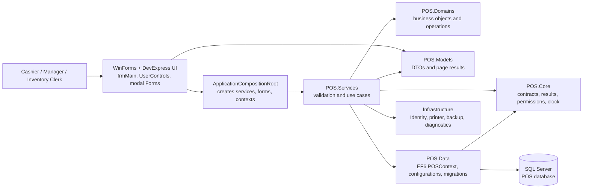

### Main projects

| Project | Responsibility | Defense explanation |
|---|---|---|
| `POS` | WinForms screens and composition | Presents workflows but should not own the business rules. |
| `POS.Services` | Use cases and application rules | The main application boundary; validates, coordinates, and persists operations. |
| `POS.Models` | DTOs and results | Defines data exchanged between UI and services without exposing persistence entities directly. |
| `POS.Domains` | Business objects and operation concepts | Represents products, sales, stock, security, purchasing, and store configuration. |
| `POS.Core` | Stable abstractions and cross-cutting contracts | Contains result types, clocks, authorization contracts, printer/backup contracts, and permission codes. |
| `POS.Data` | EF6 persistence | Contains `POSContext`, entity configurations, migrations, auditing hooks, and repository support. |
| `POS.Common` | Shared constants and utility values | Prevents repeated values from being redefined in different layers. |
| `POS.Tests` | Automated verification | Tests business and integration behavior. |

---

## 3. Architecture: how the Onion approach works here

### 3.1 What Onion Architecture means

Onion Architecture organizes a system around the business core. Dependencies point inward toward stable business concepts and abstractions. UI, databases, and external devices belong near the outside because they are replaceable mechanisms.

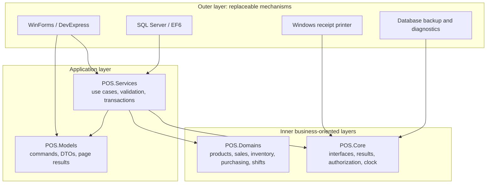

### 3.2 How this project applies it

The project follows Onion principles in these important ways:

- Forms call services rather than directly changing database records.
- Business operations are named and centralized: `SalesService`, `SaleReturnService`, `GoodsReceiptService`, `CashierShiftService`, `InventoryLedgerService`, and related services.
- Core interfaces abstract replaceable concerns such as the clock, current user, authorization, backup, diagnostics, and receipt printing.
- DTOs protect the UI from depending on EF tracking behavior and database entity shape.
- The composition root wires concrete implementations together in one place.
- Database writes, security checks, audit behavior, and transaction rules are enforced below the UI, so a rule cannot be bypassed merely by creating another form.

### 3.3 Important qualification for defense

This is best described as **onion-inspired layered architecture**, not a claim of a mathematically perfect textbook Onion implementation. In the current codebase, `POS.Services` uses `POS.Data` and EF6 to perform application work. That is a practical choice for this desktop system, but it means the infrastructure dependency is not fully inverted behind repositories everywhere.

A strong defense answer is:

> “We applied the central Onion idea—business and application rules are kept away from the UI, and replaceable concerns are exposed through contracts. Because this is a .NET Framework desktop application, some service implementations directly use the EF6 data context for transactional consistency and delivery speed. Therefore, the architecture is onion-inspired and layered rather than claiming strict dependency inversion for every persistence call.”

That answer is more accurate and defensible than calling it a strict Onion Architecture when the project contains direct EF service usage.

### 3.4 Dependency direction

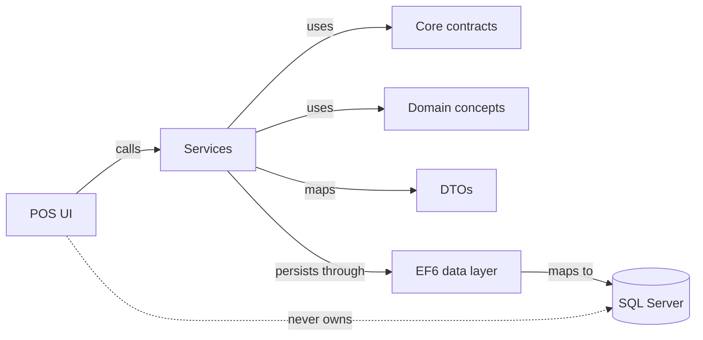

The UI should not be the authority for:

- total calculation;
- tax calculation;
- permission decisions;
- stock availability;
- duplicate request detection;
- return eligibility;
- shift closing rules;
- database transaction boundaries;
- audit record creation.

Those rules belong in services, domain concepts, or the persistence boundary.

---

## 4. Module map

| Module | Main responsibility | Typical service(s) | Main data |
|---|---|---|---|
| Authentication and authorization | Login, roles, permissions, protected actions | `AuthorizationService`, `UserService`, `RoleService`, `PermissionGuard` | Users, Roles, UserRoles, Modules, RoleClaims |
| Products and categories | Product identity, price, unit, category, active state | `InventoryService` and product workflows | Products, Categories, product identifiers |
| Inventory | Current balance and inventory history | `InventoryLedgerService`, `StockCountService` | InventoryBalances, StockMovements, StockCounts |
| Purchasing | Suppliers, purchase orders, receiving, supplier returns | `SupplierService`, `PurchaseOrderService`, `GoodsReceiptService`, `PurchaseReturnService` | Suppliers, SupplierProducts, PurchaseOrders, GoodsReceipts |
| Customers | Customer profile and lookup | `CustomerService` | Customers |
| Sales | Cart, calculation, checkout, payment, receipt | `SalesCartService`, `SalesCalculator`, `SalesService`, `SaleReceiptService` | Sales, SaleItems, Payments |
| Returns | Sale return, refund, exchange, disposition | `SaleReturnService` | SaleReturns, SaleReturnLines, RefundPayments |
| Shifts and cash | Open shift, cash in/out, close shift | `CashierShiftService` | CashierShifts, CashMovements |
| Reports | Operational and management queries | `ManagementReportService`, `ReportOutputService` | Read models over sales, stock, purchasing, shifts |
| Maintenance | Backup, restore, diagnostics, audit archive | `DatabaseMaintenanceService`, audit services | Backup files, AuditLogs, maintenance DTOs |
| Settings | Store, tax, registers, numbering | `StoreSettingsService`, `RegisterStationService`, `NumberSequenceService` | StoreSettings, TaxRates, RegisterStations, NumberSequences |

---

## 5. Retail business process

Retail is not only “selling a product.” It is a controlled cycle that connects catalog data, inventory, cash, customers, and history.

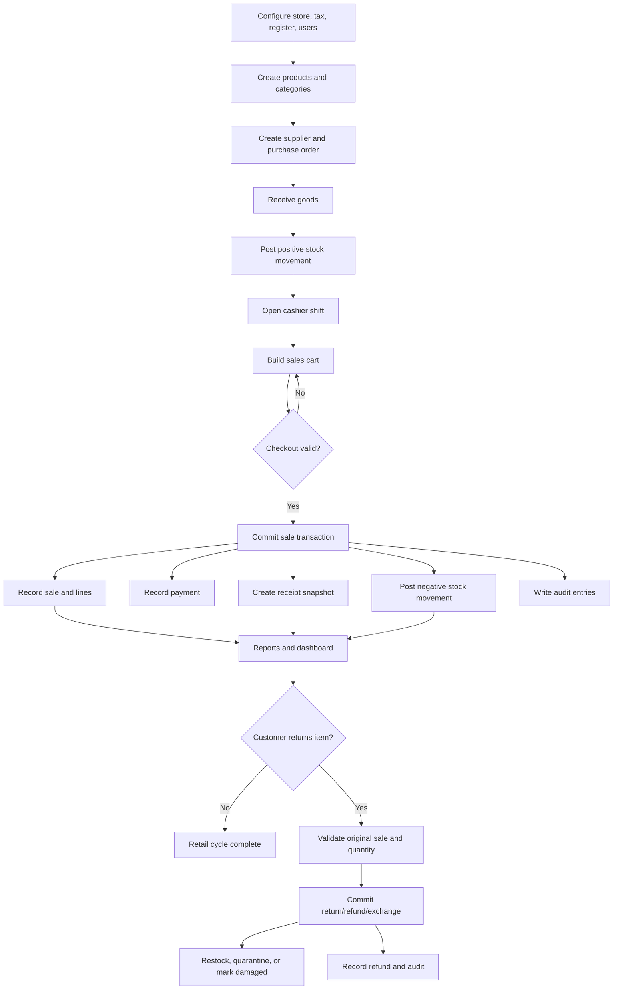

### Retail product lifecycle

1. A product is created with a stable identifier such as SKU or barcode.
2. The product may be associated with a category, unit, supplier, selling price, and tax treatment.
3. Receiving increases inventory through a stock movement.
4. A sale decreases inventory through another stock movement.
5. The completed sale stores enough historical information to reproduce the receipt.
6. A return validates what was originally sold and applies a controlled disposition.
7. Reports read the resulting transactions and movements rather than relying only on the current product record.

This separation matters because the product record changes over time, but a completed business document must remain historically stable.

---

## 6. Database module

### 6.1 Database technology and entry point

The database module uses:

- SQL Server as the relational database;
- Entity Framework 6 as the object-relational mapper;
- `POS.Data.Context.POSContext` as the central EF context;
- EF migrations for schema evolution;
- ASP.NET Identity tables for users, roles, claims, logins, and role membership;
- explicit entity configuration classes for relationships, indexes, precision, and delete behavior.

`POSContext` exposes sets for sales, sale lines, payments, inventory, stock movements, suppliers, purchasing, customers, returns, shifts, cash movements, settings, and audit logs. It also overrides `SaveChanges` and `SaveChangesAsync` to enforce append-only rules and generate audit records before persistence.

### 6.2 Conceptual entity relationship diagram

The following is a defense-level ERD. It shows the business relationships without reproducing every physical column.

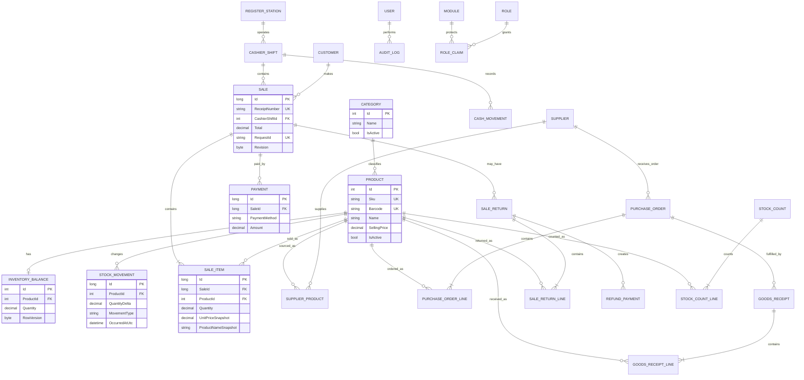

### 6.3 Major table groups

| Group | Tables/entities | Why the group is separate |
|---|---|---|
| Catalog | Product, Category, product identifiers | Product master data is reused by sales, purchasing, and inventory. |
| Inventory | InventoryBalance, StockMovement, StockCount, StockCountLine | A fast current balance is separated from the historical movement ledger. |
| Purchasing | Supplier, SupplierProduct, PurchaseOrder, PurchaseOrderLine, GoodsReceipt, GoodsReceiptLine, PurchaseReturn | Ordering and receiving have different lifecycle states and documents. |
| Sales | Sale, SaleItem, Payment | A sale header has many item lines and can have payment records. |
| Returns | SaleReturn, SaleReturnLine, RefundPayment | Returns are separate documents linked to the original sale. |
| Cash | CashierShift, CashMovement, RegisterStation | Cash accountability is tied to the cashier shift and register. |
| Security | Users, Roles, UserRoles, UserClaims, Modules, RoleClaims | Identity and resource permissions are separated from business transactions. |
| Configuration | StoreSetting, TaxRate, NumberSequence, RegisterStation | Store rules and numbering are data-driven rather than hard-coded in forms. |
| Audit | AuditLog | Business changes are recorded independently and append-only. |

---

## 7. Does the database use normalization?

### Short answer

**Yes. The operational database is substantially normalized, approximately following the goals of Third Normal Form.** It is not “pure normalization at any cost,” because some intentional denormalization is required for historical documents, reporting performance, and compatibility.

### 7.1 What normalization means

Normalization organizes relational data so each fact has an appropriate home and update anomalies are reduced.

| Normal form | Meaning | POS example |
|---|---|---|
| 1NF | Values are atomic; there are no repeating groups in one field. | Sale items are rows in `SaleItems`, not a comma-separated product list in `Sales`. |
| 2NF | Non-key attributes depend on the whole key, not only part of a composite key. | A purchase line stores line-specific quantity and cost, while supplier details stay in `Suppliers`. |
| 3NF | Non-key attributes do not depend on another non-key attribute. | Category name belongs in `Categories`; a product references the category instead of repeating category data on every transaction. |

### 7.2 Evidence of normalization in this system

- Sales are split into a header (`Sale`) and detail rows (`SaleItem`).
- Purchase orders are split into a header and `PurchaseOrderLine` rows.
- Goods receipts are separate from purchase orders because an order and its physical receipt are different events.
- Supplier data is stored in `Supplier`, and supplier-product relationships are represented separately.
- Payments are separate from sales, allowing payment method and amount to be modeled explicitly.
- Customers are separate from sale records and are linked by relationship rather than duplicated as a full customer object.
- Permissions are modeled through modules and role claims rather than hard-coding every permission on every form.
- Inventory has a current balance table and an immutable movement ledger with distinct responsibilities.

### 7.3 Intentional denormalization

The following are deliberate exceptions, not accidental duplication:

1. **Sale and sale-line snapshots** — completed receipts preserve product name, price, tax, and other relevant values as they were at checkout. If the product is renamed or repriced later, the old receipt must not change.
2. **Current inventory balance** — the balance is a read-optimized projection, while the movement ledger remains the historical source for reconciliation.
3. **Report summaries or query DTOs** — calculated outputs may combine data for fast presentation and should not be treated as master tables.
4. **Legacy/transitional product quantity fields** — if retained for compatibility, they must not replace the authoritative inventory ledger.

The defense distinction is:

> Normalization is used for current operational facts. Historical snapshots and read projections are intentionally denormalized because preserving business-document history and query performance are more important than eliminating every repeated value.

### 7.4 What anomalies normalization prevents

- **Update anomaly:** changing a supplier name does not require editing every purchase line.
- **Insert anomaly:** a supplier can be created before its first purchase order.
- **Delete anomaly:** deleting one sale line does not delete the product master record.
- **History anomaly:** changing the current product price does not rewrite an already issued receipt because the receipt has a snapshot.

---

## 8. Inventory design: balance plus ledger

Inventory uses two complementary views:

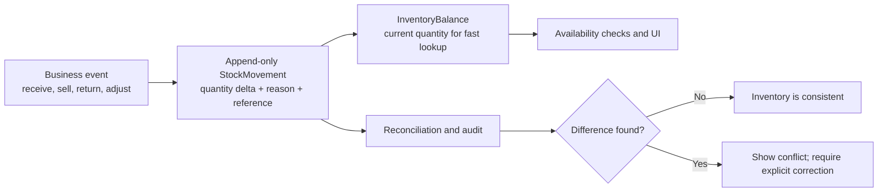

### Why not store only a quantity?

A single quantity is fast but cannot answer “how did we get here?” A movement ledger preserves the history of receipts, sales, returns, and adjustments. The balance supports fast availability checks. Together they provide both performance and traceability.

### Important integrity rules

- Stock movements are append-only. A wrong movement is corrected by another movement, not by editing history.
- Inventory changes occur inside the same business transaction as the event that caused them.
- Reconciliation reports a conflict instead of silently overwriting the balance.
- Concurrency uses row-version or revision checks so two users do not unknowingly overwrite the same state.

---

## 9. Checkout transaction

### 9.1 Checkout sequence

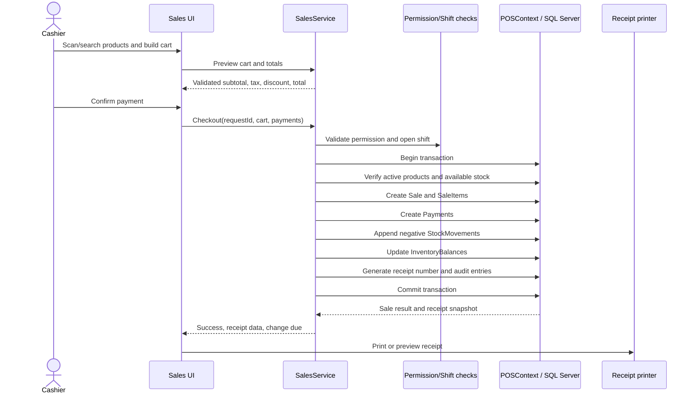

### 9.2 Atomicity

The important question is: “What if payment succeeds but stock deduction fails?” The answer should be:

> Payment, sale rows, stock movements, balance updates, receipt numbering, and the business audit event are coordinated within one database transaction. If a validation, concurrency, or persistence step fails, the transaction is rolled back and the UI receives an error instead of a partially completed sale.

### 9.3 Idempotency

Checkout accepts a request identifier. If the cashier clicks the button twice or the UI retries after a timeout, the service can recognize the already-processed request instead of creating a duplicate sale.

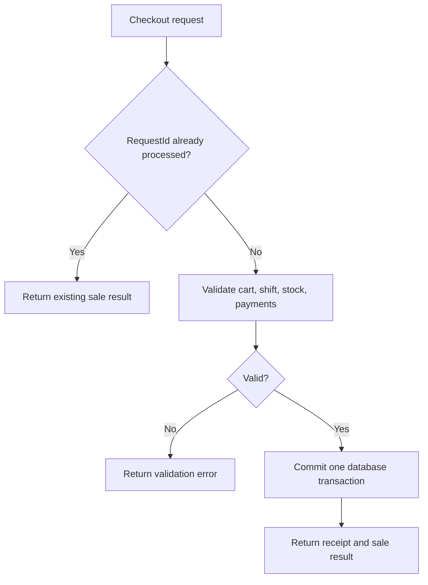

---

## 10. Returns, refunds, and exchanges

Returns are not simply negative sales. They require validation against the original sale and a decision about what happens to the physical item.

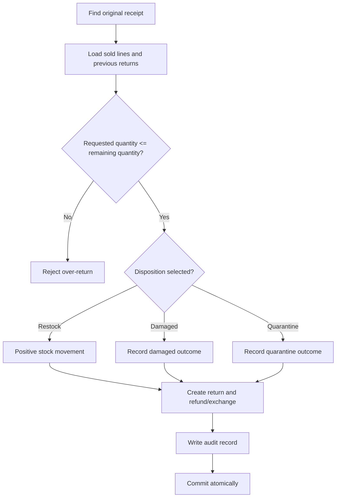

The service must protect against:

- returning more than was sold;
- returning an item from an unrelated receipt;
- refunding without a valid return record;
- restocking a damaged item as sellable stock;
- repeating the same return request;
- changing a completed return without a controlled correction path.

---

## 11. Shifts and cash accountability

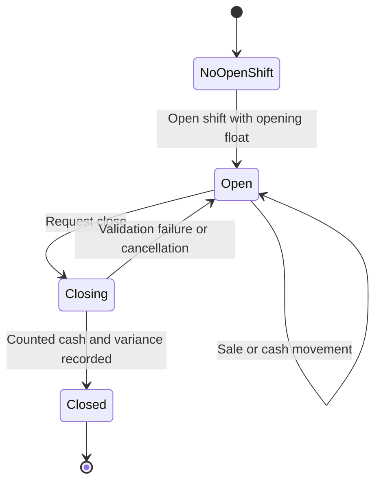

`CashierShiftService` should enforce that:

- a cashier cannot make sales without an applicable open shift;
- the register and user context are attributable;
- cash-in and cash-out movements are recorded with a reason and request identity;
- close-shift totals are calculated from recorded transactions and movements;
- an expected-versus-counted variance is visible rather than silently hidden;
- a closed shift cannot be casually reopened or edited.

---

## 12. Auditing and security

### 12.1 Permission model

Permissions are resource-based and action-based:

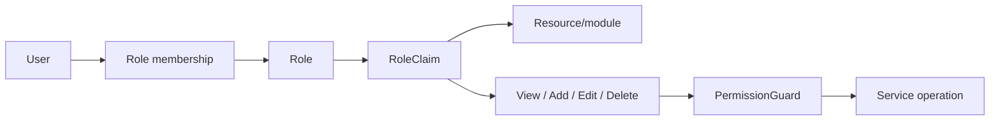

The service layer must remain the security boundary. Hiding a navigation item is useful for usability, but it is not sufficient security because another caller could invoke the operation directly.

### 12.2 Audit design

`POSContext.OnBeforeSaveChanges` inspects pending EF changes and creates audit entries. It attaches:

- entity/table name;
- action such as Added, Modified, or Deleted;
- current user;
- UTC timestamp;
- correlation identifier;
- register attribution when available;
- allowlisted old and new values.

Audit logs and stock movements are protected as append-only. Attempts to modify or delete them are rejected before EF saves the transaction.

### 12.3 What should never be logged

- passwords;
- password hashes or credential secrets;
- full payment card data;
- connection strings;
- private authentication tokens.

---

## 13. EF6 persistence and migrations

### Migration explanation

EF migrations provide versioned, repeatable schema changes. Instead of manually modifying every installation, the application can apply known migrations in order.

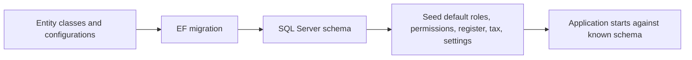

The repository contains migrations for the initial schema, inventory, identity/permissions, audit, operations foundation, uniqueness rules, concurrency/idempotency fields, return guards, and management indexes.

### Why use migrations?

- schema changes are reviewable in source control;
- new installations can be initialized consistently;
- deployment can move the database forward in known steps;
- constraints and indexes are created as part of the application version;
- seed data can establish the initial administrator and baseline permissions.

### Maintenance and restore safety

Restoring a backup should use a safe workflow:

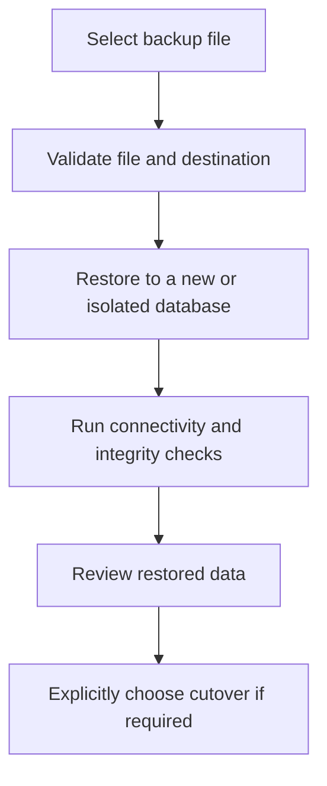

The safe rule is never to silently overwrite the live database during a normal restore action.

---

## 14. UI architecture and assigned screens

The shell is `frmMain`. UserControls are suited to dashboard/list modules that stay inside the shell, while Forms are suited to focused modal workflows.

| UI | Purpose | Backend boundary |
|---|---|---|
| `frmCloseShift` | Count cash, calculate expected amount, show variance, close shift | `CashierShiftService` |
| `ucReceipts` | Search completed receipts and inspect/print receipt details | `SaleReceiptService` / sales query services |
| `frmSaleReturn` | Select original sale, choose lines and disposition, process return | `SaleReturnService` |
| `frmChangePassword` | Validate current password and set a new password | Identity/user service |
| `ucMaintenance` | Backup, restore, diagnostics, audit maintenance | `DatabaseMaintenanceService`, audit services |

### UI rule of thumb

The form should:

1. collect input;
2. display validation feedback;
3. call a service;
4. display the service result;
5. refresh or close after success.

The form should not:

- calculate authoritative sale totals independently;
- update stock directly;
- bypass permission checks;
- perform ad hoc SQL updates;
- delete audit or stock history;
- decide whether a return is valid based only on visible controls.

### Composition root

`ApplicationCompositionRoot` centralizes the creation of service and form dependencies. This is valuable because:

- production forms receive real services;
- tests can provide controlled dependencies where supported;
- context ownership is visible;
- navigation does not need to know how every service is constructed;
- a replacement implementation can be wired in one location.

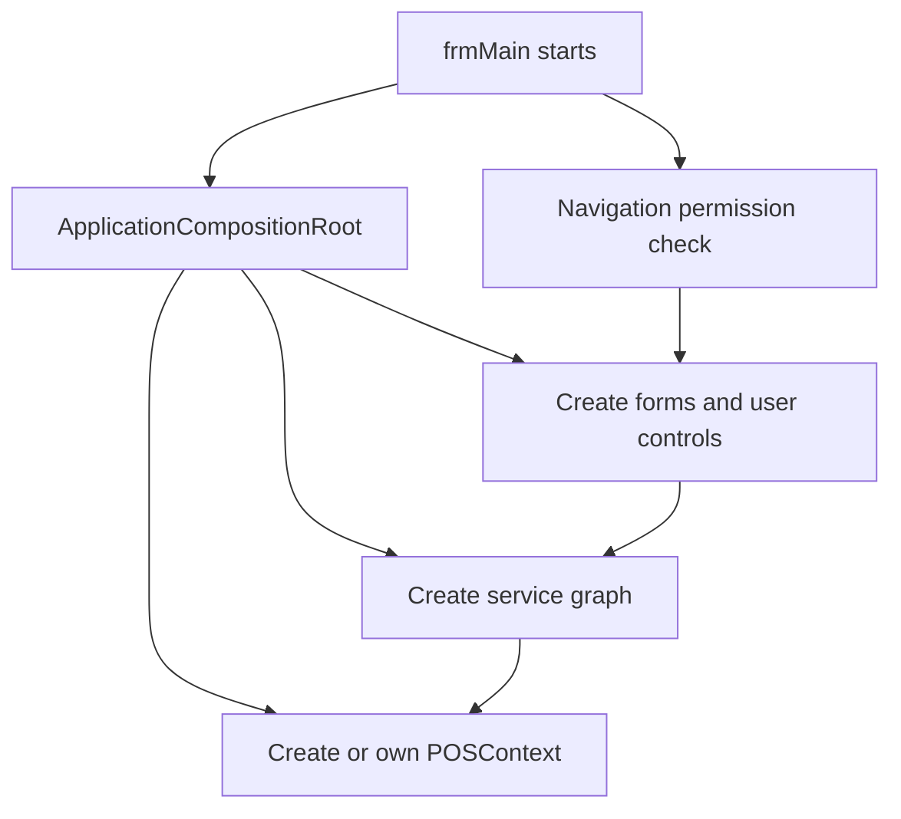

---

## 15. Defensive answers to likely panel questions

### Why did you use a service layer?

To centralize business rules and prevent multiple forms from implementing different versions of checkout, returns, permissions, or inventory updates. It also gives one place to manage transactions and audit behavior.

### Why not put the SQL in the forms?

That would tightly couple the UI to persistence, duplicate rules, make testing harder, and allow one screen to bypass controls enforced by another screen. The form is an interaction boundary, not the business authority.

### Is the database normalized?

Yes, the operational schema is substantially normalized to approximately 3NF. Headers and lines, suppliers, customers, payments, permissions, and inventory events are separated. Intentional snapshots and current-balance projections are denormalized for historical correctness and performance.

### Why are sale values copied into sale lines?

Those are historical snapshots. A receipt issued yesterday must still show yesterday’s product name, price, tax, and totals even if the product master changes today.

### Why store both inventory balance and stock movements?

The balance makes availability queries fast; the append-only ledger provides traceability and reconciliation. One is the current projection, and the other explains how the quantity changed.

### What happens if checkout fails halfway through?

The operation uses a transaction. If any required step fails, the transaction rolls back so the system does not keep a payment without a sale or deduct stock without a completed sale.

### What happens if the cashier double-clicks Pay?

The checkout request carries a request identifier. A repeated request can return the existing result instead of creating a second sale.

### How does concurrency work?

Critical records use revision or row-version checks. If another operation changes the same record first, the second operation receives a conflict instead of silently overwriting the first operation.

### Why use UTC timestamps?

UTC gives a consistent storage reference for audit and transaction order. The store timezone is used when displaying dates to staff.

### Why use a soft-active state instead of deleting products?

Historical sales, stock movements, and reports still refer to old products. Deactivating a product prevents new use while preserving historical relationships.

### Why use SQL Server?

The application needs relational integrity, transactions, indexes, constraints, reporting queries, backup, and multi-table consistency. SQL Server is appropriate for those requirements and integrates with EF6 and the .NET Framework stack.

### Is this microservices architecture?

No. It is a modular monolithic desktop application. The modules are separated in code and services, but they share one application process and database. That is appropriate for a single-store POS where local reliability and simple deployment are priorities.

### What is the biggest architecture limitation?

The system is onion-inspired rather than a pure dependency-inverted Onion implementation because service implementations still use EF6 data access directly in places. A future refinement could introduce more persistence ports/repositories or query abstractions without changing the UI workflows.

### What is the biggest operational limitation?

The deployment is oriented toward a single store/register scenario. Multi-branch synchronization, offline replication, and distributed conflict resolution would require additional design.

---

## 16. Testing and verification defense

Use a layered verification story:

| Verification level | What it proves |
|---|---|
| Compile/build | References, types, and project integration are valid. |
| Unit tests | Calculations and isolated service rules behave as expected. |
| Integration tests | EF mappings, transactions, migrations, and persistence behavior work together. |
| UI smoke tests | Forms open, bind, validate, navigate, and display service results. |
| Workflow tests | Checkout, return, receiving, shift close, backup, and restore work end to end. |
| Failure tests | Duplicate requests, insufficient stock, stale revisions, invalid permissions, and restore mistakes are rejected safely. |

Useful manual scenarios:

1. Receive ten units, sell two, and verify the balance is eight.
2. Attempt to sell more than available stock when negative stock is disabled.
3. Repeat the same checkout request and verify no duplicate sale is created.
4. Return one sold unit and verify the remaining returnable quantity decreases.
5. Attempt to return more than was sold and verify rejection.
6. Close a shift with a deliberate cash variance and verify it is recorded.
7. Rename or reprice a product and verify an old receipt remains unchanged.
8. Attempt to edit a stock movement or audit record and verify the save is rejected.
9. Log in with different roles and verify both navigation visibility and service authorization.
10. Restore a backup to an isolated target and verify the live database is not overwritten.

### Current repository verification note

At the time this guide was prepared, the Release solution build completed with **0 errors**. The merged branch still reports **19 missing-reference warnings related to Syncfusion assemblies**, and the automated test suite was not rerun as part of writing this document. Do not present the project as warning-free until those references are restored or removed and the tests are executed again.

---

## 17. Strengths, trade-offs, and future improvements

### Strengths

- Business rules are centralized in services.
- Multi-table retail operations are transaction-oriented.
- Inventory has both fast lookup and historical traceability.
- Completed receipts preserve historical snapshots.
- Permissions are resource/action based.
- Audit and stock history are append-only.
- Request identifiers reduce duplicate financial operations.
- EF migrations make schema evolution reviewable.
- The UI uses a composition root instead of constructing an uncontrolled service graph in every form.

### Trade-offs

- Direct EF usage in some services makes delivery simpler but reduces strict infrastructure isolation.
- A desktop application is simpler to deploy for one store but less suitable for distributed branches without additional architecture.
- Snapshot columns intentionally repeat historical data.
- A current balance projection requires reconciliation logic.
- EF6 and .NET Framework are stable in this project but older than modern .NET alternatives.

### Reasonable next improvements

- Resolve the remaining Syncfusion references or remove unused references.
- Complete UI acceptance testing for every assigned screen.
- Add more integration tests around migrations, idempotency, and concurrent updates.
- Introduce explicit persistence ports where strict dependency inversion is required.
- Add structured operational metrics and health checks.
- Define a multi-store strategy before introducing branches or cloud synchronization.

---

## 18. Glossary

| Term | Meaning |
|---|---|
| Aggregate | A group of related data changed as one business operation, such as a sale with its lines and payments. |
| Atomicity | The whole operation succeeds or none of it is committed. |
| DTO | Data Transfer Object; a shape used to move data between layers. |
| Idempotency | Repeating the same request does not create an additional effect. |
| Ledger | An append-only history of movements or events. |
| Migration | A versioned database schema change. |
| Normalization | Structuring relational data to reduce duplication and update anomalies. |
| Projection | A read-optimized representation derived from authoritative data. |
| Snapshot | A value copied at the time of a transaction so history stays stable. |
| Soft delete/deactivation | Marking a record inactive instead of physically deleting it. |
| Transaction | A database unit of work with commit or rollback behavior. |
| Revision/row version | A concurrency token used to detect stale updates. |

---

## 19. Final defense narrative

“This POS is designed around retail business integrity rather than only screen functionality. A product enters the system through catalog and purchasing workflows, becomes inventory through a receipt, is sold through a validated cashier shift, and is removed from inventory through an atomic checkout transaction. The sale stores its own historical snapshot so receipts remain correct. Returns validate the original sale and apply an explicit disposition. Cash movements and shift closing provide accountability. Users receive permissions through roles and resource claims, while changes are audited through the EF context. The database is normalized for operational facts, with intentional denormalization for historical snapshots and fast projections. The application follows onion principles by keeping UI concerns outside the service and domain rules, while acknowledging that direct EF usage in some services makes the implementation onion-inspired rather than a strict textbook version.”

